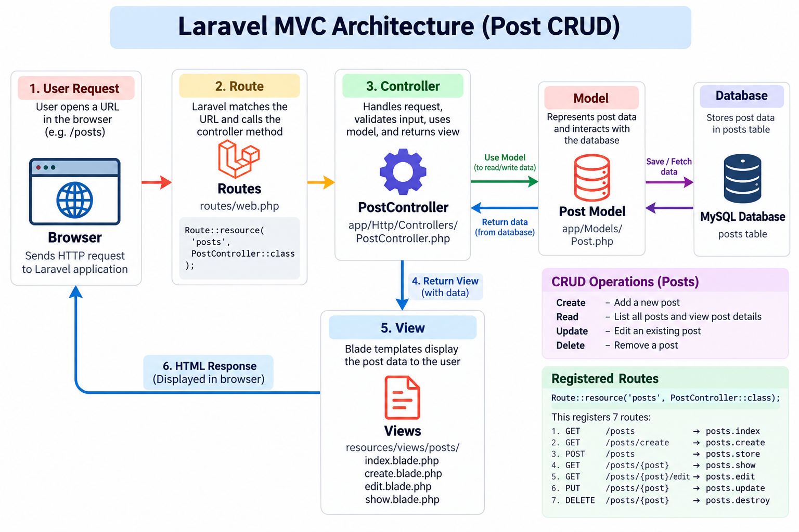

<p align="center"><a href="https://laravel.com" target="_blank"></a></p>

<p align="center">
<a href="https://github.com/laravel/framework/actions"></a>
<a href="https://packagist.org/packages/laravel/framework"></a>
<a href="https://packagist.org/packages/laravel/framework"></a>
<a href="https://packagist.org/packages/laravel/framework"></a>
</p>

## About Laravel

Laravel is a web application framework with expressive, elegant syntax. We believe development must be an enjoyable and creative experience to be truly fulfilling. Laravel takes the pain out of development by easing common tasks used in many web projects, such as:

- [Simple, fast routing engine](https://laravel.com/docs/routing).
- [Powerful dependency injection container](https://laravel.com/docs/container).
- Multiple back-ends for [session](https://laravel.com/docs/session) and [cache](https://laravel.com/docs/cache) storage.
- Expressive, intuitive [database ORM](https://laravel.com/docs/eloquent).
- Database agnostic [schema migrations](https://laravel.com/docs/migrations).
- [Robust background job processing](https://laravel.com/docs/queues).
- [Real-time event broadcasting](https://laravel.com/docs/broadcasting).

Laravel is accessible, powerful, and provides tools required for large, robust applications.

## Learning Laravel

Laravel has the most extensive and thorough [documentation](https://laravel.com/docs) and video tutorial library of all modern web application frameworks, making it a breeze to get started with the framework.

In addition, [Laracasts](https://laracasts.com) contains thousands of video tutorials on a range of topics including Laravel, modern PHP, unit testing, and JavaScript. Boost your skills by digging into our comprehensive video library.

You can also watch bite-sized lessons with real-world projects on [Laravel Learn](https://laravel.com/learn), where you will be guided through building a Laravel application from scratch while learning PHP fundamentals.

## Agentic Development

Laravel's predictable structure and conventions make it ideal for AI coding agents like Claude Code, Cursor, and GitHub Copilot. Install [Laravel Boost](https://laravel.com/docs/ai) to supercharge your AI workflow:

```bash
composer require laravel/boost --dev

php artisan boost:install
```

Boost provides your agent 15+ tools and skills that help agents build Laravel applications while following best practices.

## Contributing

Thank you for considering contributing to the Laravel framework! The contribution guide can be found in the [Laravel documentation](https://laravel.com/docs/contributions).

## Code of Conduct

In order to ensure that the Laravel community is welcoming to all, please review and abide by the [Code of Conduct](https://laravel.com/docs/contributions#code-of-conduct).

## Security Vulnerabilities

If you discover a security vulnerability within Laravel, please send an e-mail to Taylor Otwell via [taylor@laravel.com](mailto:taylor@laravel.com). All security vulnerabilities will be promptly addressed.

## License

The Laravel framework is open-sourced software licensed under the [MIT license](https://opensource.org/licenses/MIT).


## MVC Architecture

MVC stands for Model-View-Controller. It separates an application into three main components.

### 1. Model
The `Post` model represents post data and interacts with the database using Laravel Eloquent ORM.

File: `app/Models/Post.php`

### 2. View
Blade templates display the post data to the user. The views include listing, creating, editing, and viewing posts.

Files:
- `resources/views/posts/index.blade.php`
- `resources/views/posts/create.blade.php`
- `resources/views/posts/edit.blade.php`
- `resources/views/posts/show.blade.php`

### 3. Controller
The `PostController` handles requests, validates input, communicates with the model, and returns views or redirects.

File: `app/Http/Controllers/PostController.php`

### Request and Data Flow

1. The user sends a request through the browser.
2. Laravel routes the request to the appropriate controller method.
3. The controller uses the Post model to read or modify database records.
4. The controller returns a Blade view with the required data.
5. Laravel renders the view and sends the HTML response to the browser.

### CRUD Operations

- Create: Add a new post.
- Read: List posts and display post details.
- Update: Edit an existing post.
- Delete: Remove a post.

### Routes

Laravel resource routes are registered in `routes/web.php`:

`Route::resource('posts', PostController::class);`

This registers the standard routes for all seven CRUD-related actions.


## MVC Architecture Diagram

The following diagram illustrates how requests flow through Laravel's MVC architecture.




## Week 3 Day 4 — Database Integration

### Database Relationships

Implemented a one-to-many relationship between posts and comments using Laravel Eloquent ORM.

- `Post` model: Uses `hasMany()` to retrieve associated comments.
- `Comment` model: Uses `belongsTo()` to retrieve its parent post.
- The comments migration includes a `post_id` foreign key with cascading deletion.

### Factories and Seeders

Created `PostFactory` and `CommentFactory` to generate realistic test data.

Created `PostCommentSeeder` to generate 20 posts, each with 1–5 comments.

### Eloquent Queries

Practised the following queries:

- `where()` — filters posts by author.
- `orderBy()` — sorts posts by creation date.
- `with()` — eagerly loads related comments or their parent post.
- `has()` — finds posts that have comments.

### Verification

Verified the database records using Laravel Tinker:
- Posts: 21
- Comments: 40

Tested the post-comment relationships in both directions.
